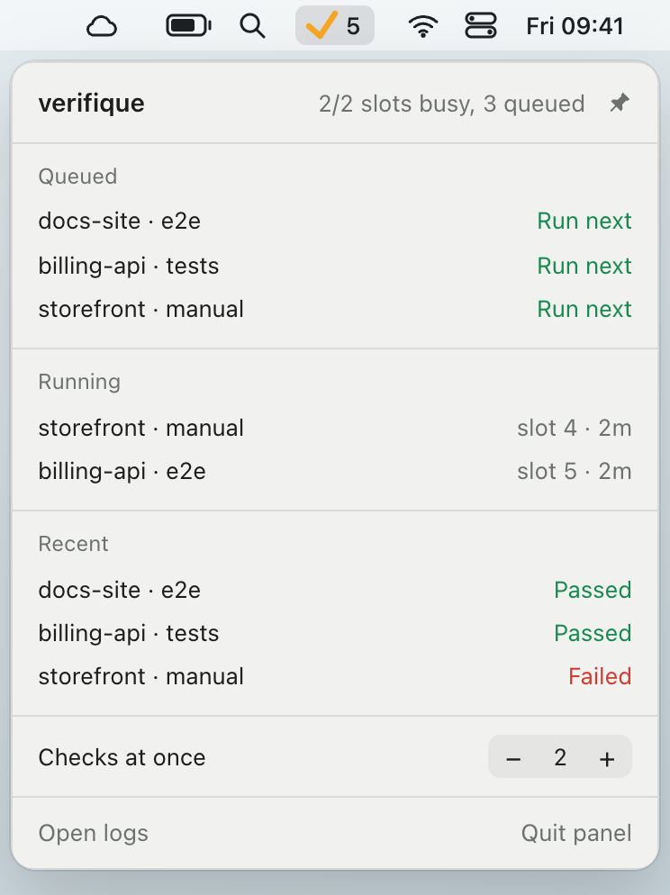

# verifique

A verification queue for coding agents.

Coding agents write code faster than anyone can check that it works. verifique is for running as many as you like and still trusting what they hand you. [verifique.ai](https://verifique.ai) has a two-minute film about it.

## What it's for

Writing code scales to dozens of agents. Verifying it on one laptop doesn't.

Run fifteen agents and they tend to finish around the same time. Each one starts a copy of your app
to check its work, and they collide over ports, databases and memory. Worktrees separate your files,
not any of that. Moving to the cloud avoids the collisions, but gives up the fast feedback of working
locally.

verifique keeps verification on your laptop and runs only as many checks at once as you allow, two by
default. Agents hand their work over instead of fighting over the machine, and a second agent that
starts fresh checks it. When many agents finish at once, their checks wait their turn.

## How it works

1. **An agent hands its work over.** It submits your original request and how to reach the change.
   Uncommitted work is captured for it.
2. **It keeps working.** It waits in the background. Repositories take turns, and fixes go ahead of
   new work.
3. **The check runs when a slot is free.** Your app runs natively, with its own ports and fresh
   databases on the servers you already have.
4. **The check ends in a verdict with proof.** A check can be any command, such as a test suite, or
   a fresh agent that compares the work with what you asked for. If it fails, the agent that
   submitted it fixes it.

```
agents, in any repo            server                       your laptop
───────────────────            ──────                       ───────────
verifique submit ───────▶ queue ─▶ a slot is free ───────────▶ fresh databases, your apps, your check
verifique wait   ◀────── verdict stored against the content ◀─ pass, fail or blocked
```

One server runs per machine and serves every project on it, because projects share the machine's
memory and ports. It doesn't depend on your framework or on how you test.

## Status

Version 0.3, and early. It has been used on copies of three web apps and an iOS app, with Claude Code
as the checker. Each release passes its tests and the example shop on macOS, Linux and Windows.
Android and other checkers have had little testing so far. [docs/DESIGN.md](docs/DESIGN.md) has the
decisions behind it.

## Get started

You need your database servers already running (Postgres, MongoDB or Redis), and Claude Code and Node
for agent checks. To try it before connecting a project, [examples/shop](examples/shop) is a one-page
shop with a broken Search button, which takes about two minutes.

<a name="install"></a>

### 1. Install

verifique runs on macOS, Linux and Windows, on ARM and Intel or AMD processors, and installs with each
system's own package manager, which then keeps it up to date.

**macOS**, with Homebrew:

```bash
brew install smnkgv/verifique/verifique
```

**Windows**: verifique needs [Git for Windows](https://git-scm.com/download/win)
(`winget install Git.Git`), whose `sh` runs your project's commands. Then, in PowerShell, with Scoop:

```powershell
scoop bucket add verifique https://github.com/smnkgv/scoop-verifique
scoop install verifique
```

**Linux**, from verifique's signed repositories:

<details>
<summary>Debian and Ubuntu</summary>

```bash
curl -fsSL https://smnkgv.github.io/verifique-packages/verifique.gpg | sudo tee /usr/share/keyrings/verifique.gpg > /dev/null
echo "deb [signed-by=/usr/share/keyrings/verifique.gpg] https://smnkgv.github.io/verifique-packages/deb stable main" | sudo tee /etc/apt/sources.list.d/verifique.list
sudo apt update && sudo apt install verifique
```

</details>

<details>
<summary>Fedora and RHEL</summary>

```bash
sudo curl -fsSL -o /etc/yum.repos.d/verifique.repo https://smnkgv.github.io/verifique-packages/rpm/verifique.repo
sudo dnf install verifique
```

</details>

<details>
<summary>Arch Linux (x86-64)</summary>

Trust the signing key once, add the repository, then install:

```bash
curl -fsSL https://smnkgv.github.io/verifique-packages/verifique.asc | sudo pacman-key --add -
sudo pacman-key --lsign-key BD3CA969126EAF73205EBAE45C27008897635E6B
printf '\n[verifique]\nServer = https://smnkgv.github.io/verifique-packages/arch/$arch\n' | sudo tee -a /etc/pacman.conf
sudo pacman -Syu verifique
```

</details>

**Anywhere else**, an install script puts the latest release in `~/.local/bin`, or in your user
folder on Windows:

```bash
curl -fsSL https://raw.githubusercontent.com/smnkgv/verifique/main/install.sh | sh
```

```powershell
irm https://raw.githubusercontent.com/smnkgv/verifique/main/install.ps1 | iex
```

Then start the queue, which runs in the background and starts again whenever you log in, and add
support for the databases your projects use:

```bash
verifique service install
verifique plugin add postgres redis
```

Last, decide whether you want the status-bar panel: a tick in the macOS menu bar, the Windows
notification area or a Linux tray that shows what needs you, what's running, what's queued and recent
verdicts with their proof. It's optional, and `verifique status` shows the same in a terminal.

<picture>
  <source media="(prefers-color-scheme: dark)" srcset="site/img/menubar-dark.png">
  
</picture>

To add it:

```bash
verifique panel install
```

It opens now and whenever you log in, and `verifique panel remove` takes it away again. On Linux it
needs WebKitGTK and an AppIndicator library, which Debian and Ubuntu install with
`sudo apt install libwebkit2gtk-4.1-0 libayatana-appindicator3-1`.

### 2. Connect your project

In your repository, run this and give what it prints to your coding agent:

```bash
verifique init
```

The agent reads your code and writes `verifique.yaml`: how to start your app, what two copies of it
would fight over, and which checks to run.

### 3. Prove it

```bash
verifique doctor
```

It starts two copies of your app side by side and checks that each one used its own databases.

### 4. Tell your agents

```bash
verifique init --rules
```

Add what it prints to your project's agent instructions, such as `CLAUDE.md` or `AGENTS.md`, so your
agents know how to hand their work over.

### Good to know

-   Checks run your app with the `.env` from the repository's main checkout, so keep test keys in
    it: a check reaches whatever the `.env` points at.
-   verifique only creates and drops databases named `verifique_*`. On Redis, each slot uses the
    numbered database that matches it and clears it for every check.
-   After upgrading verifique, run `verifique service restart` and `verifique plugin update`.

## Use it

From any repository or worktree, an agent hands its work over and waits for the verdict:

```bash
verifique submit --check manual --request-file request.md --brief "Open Settings, then Filters"
verifique wait <job>     # exit 0 passed, 1 failed, 2 blocked or error, 3 replaced or cancelled
```

-   Uncommitted work is included, and a verdict belongs to the content, so committing the same
    content later keeps it verified.
-   A newer submission replaces that branch's queued run of the same check, and
    `verifique cancel <job>` stops one.
-   After three failures in a row, or one `blocked`, the branch needs you: you get a notification,
    and `verifique clear` hands it back.
-   `verifique status` shows the queue, `verifique show <job>` shows one job's proof, and every
    command that reads state takes `--json`.

To use the app by hand in a slot of its own, with no check:

```bash
verifique stack start --minutes 30
verifique stack rebuild <job>   # your latest work, keeping its data; --fresh empties it
verifique stack stop <job>
```

`verifique service install --slots <n>` sets how many copies of your apps run at once, and
`verifique slots <n>` changes it while the queue runs. [specs/](specs/README.md) describes everything
verifique does, and [docs/CONFIG.md](docs/CONFIG.md) every setting in `verifique.yaml`.

## Build

With Rust 1.95 or later:

```bash
cargo build --release
cargo test
```

Then put the binary on your `PATH`. On macOS or Linux, for example:

```bash
ln -s "$PWD/target/release/verifique" ~/.local/bin/verifique
```

On Windows, add `target\release` to your user `PATH`. If your queue runs this build, run
`verifique service restart` after each build. `panel/bundle.sh` builds the panel on macOS,
`panel/bundle-windows.ps1` on Windows and `panel/bundle-linux.sh` on Linux. The tests need `git`,
`python3`, `psql`, `mongosh` and `redis-cli`, and running Postgres, Mongo and Redis.
[e2e/](e2e/README.md) tests everything from the outside, from a fresh install to a real agent.

## Licence

Apache-2.0. See [LICENSE](LICENSE).
